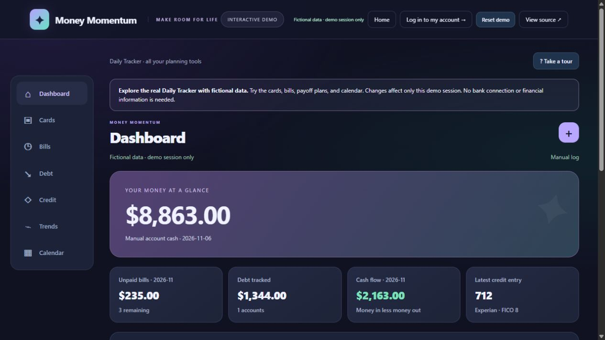
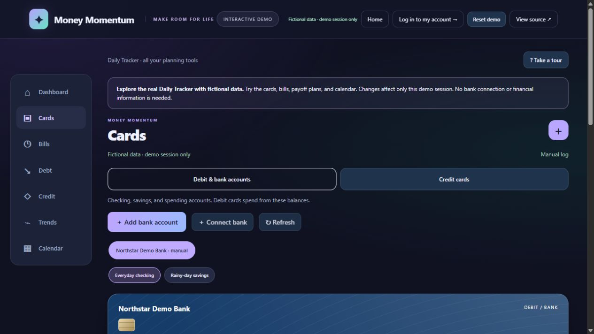
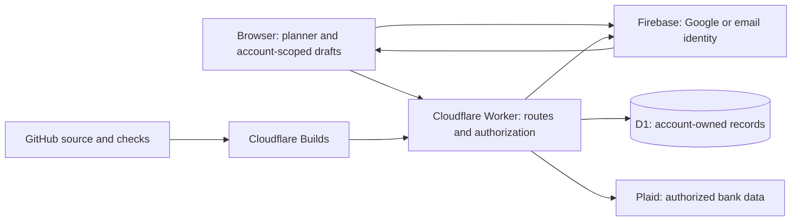

# Money Momentum

[Open the app](https://money-momentum.budgetstudio.workers.dev/) · [Try the fictional-data tutorial](https://money-momentum.budgetstudio.workers.dev/demo) · [Sign in](https://money-momentum.budgetstudio.workers.dev/login)

A personal finance web application with a public tutorial and private per-user planning. It combines manual accounts, bills, debt planning, cash-flow projections, and optional read-only bank data through Plaid.

The standalone app runs on Cloudflare Workers with Firebase Authentication and D1 storage. Its browser UI uses HTML, CSS, and JavaScript, with TypeScript server handlers. The repository also retains the React/Vinext framework shell and original Sites configuration; the current standalone deployment uses `cloudflare/full-worker.ts`.

## See the interface





These screenshots use the isolated tutorial's fictional accounts. Demo changes stay in that demo session. Real account records are loaded only after sign-in.

## What it does

- Google or email/password signup and login, password confirmation, email verification, password reset, and session logout.
- Account-owned manual records, account-scoped device drafts, versioned saves, and cross-device conflict handling.
- Desktop and phone layouts for Dashboard, Cards, Bills, Debt, Credit, Trends, and Calendar.
- Manual income, expenses, transfers, credit-card payments, running balances, and backups.
- Bill calendars, cash cushion forecasts, debt payoff estimates, and manual credit-score entries.
- Optional Plaid account linking, transaction synchronization, refresh, and disconnect cleanup.
- Optional consent-based Web Push notifications and an hourly scheduled notification job.
- A device PIN privacy screen and customizable themes.

Credit scores are manually entered; no Experian integration is implemented. Bank data is separate from the manual log and does not initiate payments or transfers.

## How the pieces connect



The browser signs in through Firebase and exchanges a verified ID token for a short-lived Worker session. The Worker authorizes API requests, strips untrusted identity headers, and scopes queries to the verified user. Plaid credentials and encrypted bank access tokens stay server-side. [Read the detailed architecture](docs/ARCHITECTURE.md).

| Area | Start reading here |
|---|---|
| Public/private routing | `cloudflare/full-worker.ts` |
| Login UI and session verification | `public/firebase-login.js`, `cloudflare/auth.mjs` |
| Device draft isolation | `public/account-storage.js` |
| Account saving | `public/device-settings.js`, `app/api/log/route.ts` |
| Planning calculations | `public/phone-core.js`, `public/tracker.js` |
| Banking | `public/bank-link.js`, `app/plaid-server.ts` |
| Schema | `drizzle/`, `cloudflare/auth-schema.sql` |
| Standalone build and deployment | `scripts/build-cloudflare-full.mjs`, `cloudflare/wrangler.jsonc` |

## Run the checks locally

Use Node.js 24 for the full suite; tests use its built-in SQLite. No real provider credentials are required for the automated tests.

```sh
npm ci
npm test
npm run build:cloudflare
npm run check:cloudflare
```

The final command packages the Worker with `--dry-run`; it does not deploy or change a remote database. Generated assets and packaged code are under `dist/` and are ignored by Git.

For a local preview of signed-out public pages, build first, then run:

```sh
npx wrangler dev --config cloudflare/wrangler.jsonc --local --ip 127.0.0.1 --port 8787 --var APP_ORIGIN:http://127.0.0.1:8787 --var FIREBASE_WEB_CONFIG:{} --inspector-port 0
```

Open `http://127.0.0.1:8787/demo`. This preview intentionally disables Firebase configuration. It is not a production identity or real-bank test. Integration tests cover private session-to-database behavior with synthetic local records. Use a separately configured HTTPS environment for live provider verification.

The retained framework development path is `npm run dev`. Its local Sites identity adapter is a development convenience, not the authentication mechanism used by the standalone public app.

## Automated pipeline and deployment

GitHub Actions runs the test suite before allowing the dependent Cloudflare packaging job to start. The second job builds the full app, checks Wrangler packaging without deployment, and saves a commit-named artifact. No production credentials are required by that workflow.

Cloudflare Builds is a separate connected service for the deployed app. Its production branch is `main`. The existing dashboard command `node scripts/build-cloudflare-demo.mjs` is kept compatible through a wrapper that invokes the full build. The deploy command uses `cloudflare/wrangler.jsonc`. A successful GitHub test run alone is not proof of a successful Cloudflare deployment or bank connection.

[Deployment and rollback guide](docs/DEPLOYMENT.md) · [Verification checklist and known limits](docs/VERIFICATION.md) · [Test-first change walkthrough](docs/TDD_BANK_FEEDBACK.md)

## Provider configuration

Firebase must have Google and email/password providers enabled and the app hostname authorized. `FIREBASE_WEB_CONFIG` contains public web-app configuration, not a service-account key. The browser and server both verify the email requirement; the server verifies the signed provider identity before issuing a session.

For the deployed standalone app, Plaid's allowed redirect list must include exactly:

```text
https://money-momentum.budgetstudio.workers.dev/account
```

Keep existing addresses needed by other deployments. Store runtime credentials directly in Cloudflare. See [PLAID_SETUP.md](PLAID_SETUP.md), [SECURITY.md](SECURITY.md), and [NOTIFICATIONS.md](NOTIFICATIONS.md).

## Limits and project scope

This is an independently developed portfolio project, not a certified financial product. Provider authorization, bank coverage, available transaction history, and delivery to real notification devices require separate live checks. Automated tests use mocked providers and do not prove regulatory compliance or general production readiness.

Device drafts and exported backups are not encrypted by the PIN privacy screen. A browser controlled by another person can bypass browser-only PIN checks. See the security guide for trust boundaries and remaining review areas.

The separately hosted ChatGPT Site and its records/bank links are independent. The standalone app starts fresh; no financial-data migration was performed. The retained `.openai/hosting.json` identifies that older Site and is not used by the standalone Wrangler configuration. [Historical source consolidation notes](SOURCE_MIGRATION.md) are retained with a current-status correction.

Source code, tests, and fictional samples belong in this repository. Passwords, provider secrets, session cookies, bank tokens, private financial screenshots, and database exports do not.
